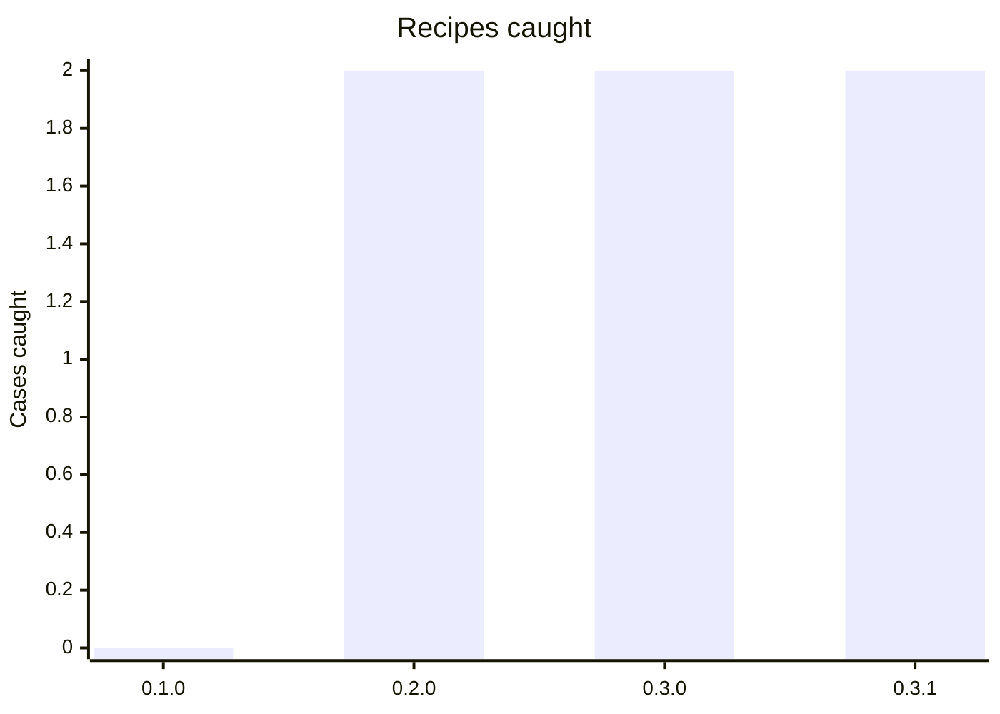
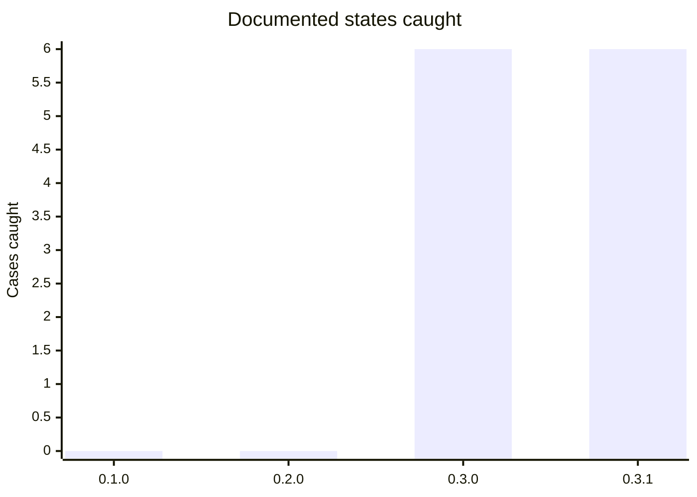

# uninvent benchmark

Fixed corpus, one result file per version. Generated from `bench/results/*.json` by `npm run bench`. Do not edit this file by hand.

Tokenizer for every token count: cl100k_base via gpt-tokenizer (OpenAI GPT-4 proxy, not the Claude or Cursor tokenizer)

## Latest

**0.3.1** (local, `f5ffeab`)

Caught 4/4 Raw controls, 2/2 Recipes, 6/6 Documented states, 2/2 Name collisions. 0 false positives on 9 clean files. Skill 630 tokens. `exists "loading button"` is 30 tokens. Reading the button source is 493 tokens.

### By category

| Version | Raw controls | Recipes | Documented states | Name collisions | Clean false positives |
| --- | --- | --- | --- | --- | --- |
| 0.3.1 | 4 / 4 | 2 / 2 | 6 / 6 | 2 / 2 | 0 fp / 9 |

### With the rule, and held out

| Category | With the rule | Held out |
| --- | --- | --- |
| Raw controls | 2 / 2 | 2 / 2 |
| Recipes | 1 / 1 | 1 / 1 |
| Documented states | 3 / 3 | 3 / 3 |
| Name collisions | 1 / 1 | 1 / 1 |
| Clean false positives | 0 fp / 6 | 0 fp / 3 |

### Tokens and time

| Version | Skill | AGENTS.md | exists | Button source | Hook line (mean) | Scan (ms) | Hook, clean file (ms) |
| --- | --- | --- | --- | --- | --- | --- | --- |
| 0.1.0 | 463 | 100 | 7 (no match) | 493 | 17.1 | 334.8 | 79.4 |
| 0.2.0 | 573 | 118 | 7 (no match) | 493 | 17.8 | 358.2 | 80.8 |
| 0.3.0 | 630 | 131 | 30 | 493 | 19.9 | 359.9 | 84.6 |
| 0.3.1 | 630 | 131 | 30 | 493 | 19.9 | 324.5 | 37.1 |

### Hook process

Cold and warm are wall-clock times for `uninvent hook` after one edit. Cold turns the V8 compile cache off. Warm reuses it. Older result files did not record this, so those cells are empty. The check column above is still `uninvent check` on one clean file.

| Version | Cold p50 | Cold p95 | Warm p50 | Warm p95 | Warm, with a finding (p50) |
| --- | --- | --- | --- | --- | --- |
| 0.1.0 | — | — | — | — | — |
| 0.2.0 | — | — | — | — | — |
| 0.3.0 | — | — | — | — | — |
| 0.3.1 | 35.8 | 37.6 | 33.9 | 38.9 | 33.9 |

## Trend

| Version | Raw controls | Recipes | Documented states | Name collisions | Clean false positives |
| --- | --- | --- | --- | --- | --- |
| 0.1.0 | 4 / 4 | 0 / 2 | 0 / 6 | 2 / 2 | 0 fp / 9 |
| 0.2.0 | 4 / 4 | 2 / 2 | 0 / 6 | 2 / 2 | 0 fp / 9 |
| 0.3.0 | 4 / 4 | 2 / 2 | 6 / 6 | 2 / 2 | 0 fp / 9 |
| 0.3.1 | 4 / 4 | 2 / 2 | 6 / 6 | 2 / 2 | 0 fp / 9 |

## Paired agent trial

Not run. No result file includes a paired trial, so there are no agent numbers. Set `UNINVENT_BENCH_API_KEY` and see [bench/README.md](bench/README.md).

## What this does and does not show

This is a checker benchmark. Each case is a file in `bench/corpus`. `caught / total` is how many non-clean cases in that category produced the finding kind the case asks for (`raw`, `rebuilt`, `reinvented`, or `export`). A clean file that prints anything is a false positive. Cases marked `with-rule` were written with the rule they exercise, including the original demo shapes. Cases marked `held-out` are different files: another control, another wording of the confirm dialog, a loader beside the button, a `cn()` class string. The corpus is not the unit-test fixture set.

A version can flag the raw elements inside a recipe file and still score 0 on recipes. The recipe category only counts a `rebuilt …` line. v0.1 does that on purpose: it has no recipes. The same is true for documented states before v0.3.

Token counts use cl100k_base, the OpenAI GPT-4 tokenizer, as a proxy. Claude and Cursor tokenize differently. Compare versions to each other. The skill and `AGENTS.md` numbers are what a turn carries if those files are in context. `exists` is one query. The source number is `button.tsx` plus its story, the files you would open to learn the same button. The hook number is the mean of the finding lines `check` prints. A clean file is 0. The hook does not print the catalog.

Latency is wall-clock time, including Node starting. The check column is the median of `uninvent check` on one file. The hook table is `uninvent hook` itself: cold with the V8 compile cache disabled, warm with the cache reused, p50 and p95 inside that sample. It will move a few milliseconds between machines. Detection counts and token counts do not, for the same version and the same corpus.

The paired agent trial is off unless `UNINVENT_BENCH_API_KEY` is set. A skipped trial has no counts. This report does not invent them. When the trial does run, the wrong-component count is how many lines `uninvent check` prints on the file the model returned. That is the checker judging the model, not a person.

Nothing here shows that a live coding agent, with tools and a hook, makes fewer mistakes or spends fewer tokens on a real task. That needs the paired trial, or a run of your own.

